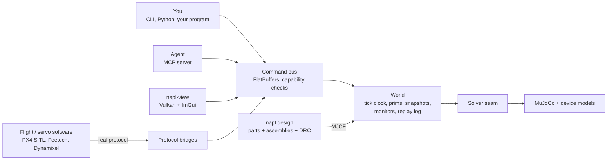

# napl


Design a robot from real, purchasable parts, check it, simulate it, and run your own flight or servo software against it, all from one deterministic kernel that people and agents drive the same way.


napl is a physics kernel (C++20 on MuJoCo) with a device layer, a sourced parts library, robots written as data, a design-rule checker and an MCP server. Your program talks to the simulated robot over the robot's real protocol (PX4 SITL via MAVLink, Feetech STS, Dynamixel 2.0), and every run leaves a replay hash.

**Start with the [user guide](docs/guide.md).** It covers install, the parts library, building and checking a robot, simulating it, flying it under PX4, driving it over its serial protocol, agents, and what is and is not validated. Every command in it was run.

## What's in it

|                     |                                                                                                                                                                                     |
| ------------------- | ----------------------------------------------------------------------------------------------------------------------------------------------------------------------------------- |
| **Kernel**          | Deterministic, replayable physics (C++20, MuJoCo) with device models: battery, ESC + BLDC motor, rotors, bus servos, IMU / baro / mag / GNSS, wind.                                 |
| **Parts library**   | `parts/`, 800+ real parts. Every number has a source and a fidelity tag (datasheet / literature / measured / derived / estimated).                                                  |
| **Robots as data**  | `assemblies/*.toml`: part instances, port mates, fasteners, pin-level wires, device bindings, sub-assemblies. `napl design build` emits MJCF plus a mass / BOM / provenance report. |
| **Editing API**     | `napl.design.Design`: add, snap, swap, remove, autowire, undo. The same operations back the MCP `design_*` tools and the viewer's Design window.                                    |
| **Design rules**    | Mechanical, electrical and performance checks. Every finding has a code, a severity and a concrete fix.                                                                             |
| **Fast simulation** | Hover / hold estimates, virtual thrust-stand benches against vendor tables, and a generated [fidelity report](docs/fidelity.md).                                                    |
| **`napl program`**  | Your program runs against the simulated robot over the real protocol, with monitors, fault injection (motor out, GNSS outage, weak cell, comms drop, ...) and a replay hash.        |
| **Agents**          | An MCP server so agents can edit, check and simulate designs. Destructive tools need approval, and programs are never an agent tool.                                                |
| **Viewer**          | Vulkan viewer with a CAD-like Design window, a HUD over the 3D view, and headless offscreen rendering.                                                                              |

## Robots built in napl

Each one is built from the parts library and documented with its measured results, misses included.

| robot                     | what it is                                                                                                       | docs                                                                                        |
| ------------------------- | ---------------------------------------------------------------------------------------------------------------- | ------------------------------------------------------------------------------------------- |
| X500 V2                   | Holybro quadrotor flown under real PX4 SITL, with a GPS-denied companion computer                                | [guide, section 6](docs/guide.md)                                                           |
| SO-101 and Koch v1.1 arms | Bus-servo arms driven over Feetech STS and Dynamixel 2.0                                                         | [guide, section 6](docs/guide.md)                                                           |
| Skydio-style quadrotor    | Vision-only flight through a seeded forest (depth camera, voxel map, sampled primitives), then landing elsewhere | [examples/skydio](examples/skydio/README.md), [skydio-land](examples/skydio-land/README.md) |
| EDF hopper                | Throttleable thrust-vectored VTVL hopper on jet vanes, landing in different places and environments              | [docs/hopper.md](docs/hopper.md), [hopper-land](examples/hopper-land/README.md)             |
| TVC lander                | Model rocket on a two-axis servo gimbal that lights a second motor to land on its legs                           | [docs/lander.md](docs/lander.md)                                                            |
| ASV                       | BlueBoat-class catamaran with COLREG-compliant avoidance in a harbour with traffic                               | [examples/asv](examples/asv/README.md)                                                      |
| cuas-lite                 | Printable turret with RP2040 firmware and a Jetson app, run in lockstep with a simulated RP2040 twin             | [docs/cuas-lite](docs/cuas-lite/spec.md)                                                    |
| Recon quadruped           | 12 kg Go2-class dog: convex MPC + whole-body QP, lidar mapping, coverage planner                                 | [docs/dog](docs/dog/README.md)                                                              |
| 4-wheel car               | Built from an empty design by an agent, then driven                                                              | [docs/showcase/car](docs/showcase/car/README.md)                                            |

## Architecture



- **Command bus.** One FlatBuffers schema (`schema/`) defines every command. JSON at the edges, capability checks (read / control / destructive) on every call.
- **World.** Single-threaded and deterministic: snapshot, fork and restore give bitwise-equal continuations, and every control command is logged for replay.
- **Solver seam.** MuJoCo is the only solver today; the kernel itself never includes `mujoco.h`.
- **Design layer.** Pure Python (standard library and numpy). It turns parts and assemblies into MJCF and reports, without the kernel.

## Repo layout

```
src/          C++ kernel: core and devices, MuJoCo solver, PX4 bridge, renderer, viewer, CLI, Python bindings
include/      public C++ headers
schema/       FlatBuffers command schema
python/napl/  Python package: CLI, design API, MCP server, protocol bridges, program runner
parts/        sourced parts library (TOML)
assemblies/   robots as data (TOML), including sub-assemblies
examples/     flight stacks, controllers and scenarios per robot
cad/          CAD for printable parts (cuas-lite, dog)
firmware/     cuas-lite RP2040 firmware
px4/          PX4 SITL airframes, parameters and bridge configs
tests/        gtest (tests/cpp) and pytest (tests/python) suites, test data and goldens
tools/        remote runner, license and parts checks, benches, video recorders
docs/         user guide, models, validation, per-robot results
```

## Build and run

napl builds and runs on a Linux build host; the laptop only edits, runs git and syncs. `tools/remote.sh` is the whole interface:

```sh
tools/remote.sh bootstrap                  # one-time: toolchain venv (cmake, ninja, uv) on the host
tools/remote.sh run [--gpu] 'CMD'          # sync the tree, run CMD in the remote source dir
tools/remote.sh bg NAME 'CMD'              # same, in tmux session napl-NAME, log in logs/NAME.log
tools/remote.sh pull PATH...               # copy remote outputs into ./remote-out/

tools/remote.sh run --nolock '.venv/bin/napl design check assemblies/x500v2.toml'
```

The host is a parameter (`NAPL_REMOTE`, `NAPL_REMOTE_DIR`), so any Ubuntu 24.04 box with GCC 13 and Python 3.12 works. For a local install you need Python >= 3.12, CMake >= 3.25, Ninja and a C++20 compiler:

```sh
uv venv && uv pip install -e '.[px4,arm,dev]'   # builds the C++ kernel with scikit-build-core into build/
tools/install_dev.sh                            # re-run after any C++ change
```

## Tests

- gtest for the kernel (`tests/cpp`, via `ctest`), with `cpu` and `gpu` labels.
- pytest for everything else (`tests/python`, pytest-xdist). Run the tests that cover what you changed; the full suite takes the whole host.
- `tools/check_licenses.py` and `tools/check_parts.py` check dependency licenses and the parts library.

## Documentation

- [docs/guide.md](docs/guide.md): the user guide, start here
- [assemblies/README.md](assemblies/README.md): assembly schema, editing API, design rules
- [parts/README.md](parts/README.md): parts schema, ports, pins, fidelity tags
- [docs/models.md](docs/models.md): device and physics models
- [docs/validation/](docs/validation/): thrust-stand and X500 hover validation
- [docs/fidelity.md](docs/fidelity.md): generated fidelity report

## License

Proprietary, part of the Neegy Applied Physics Lab code collection. All rights reserved. Dependencies are permissive only (LGPL only when dynamically linked, never GPL), checked by `tools/check_licenses.py`.
