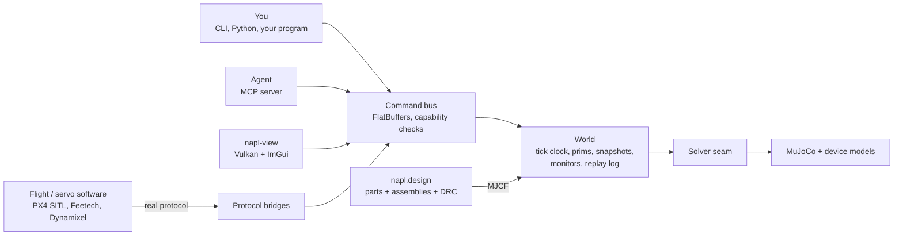

# napl


Design a robot from real, purchasable parts, check it, simulate it, and run your own flight or servo software against it, all from one deterministic kernel that people and agents drive the same way.


napl is a physics kernel (C++20 on MuJoCo) with a device layer, a sourced parts library, robots written as data, a design-rule checker and an MCP server. Your program talks to the simulated robot over the robot's real protocol (PX4 SITL via MAVLink, Feetech STS, Dynamixel 2.0), and every run leaves a replay hash.

**Start with the [user guide](docs/guide.md).** It covers install, the parts library, building and checking a robot, simulating it, flying it under PX4, driving it over its serial protocol, agents, and what is and is not validated. Every command in it was run.

## What's in it

|                     |                                                                                                                                                                                     |
| ------------------- | ----------------------------------------------------------------------------------------------------------------------------------------------------------------------------------- |
| **Kernel**          | Deterministic, replayable physics (C++20, MuJoCo) with device models: battery, ESC + BLDC motor, rotors, bus servos, IMU / baro / mag / GNSS, wind.                                 |
| **Parts library**   | `parts/`, 800+ real parts. Every number has a source and a fidelity tag (datasheet / literature / measured / derived / estimated).                                                  |
| **Robots as data**  | `assemblies/*.toml`: part instances, port mates, fasteners, pin-level wires, device bindings, sub-assemblies. `napl design build` emits MJCF plus a mass / BOM / provenance report. |
| **Editing API**     | `napl.design.Design`: add, snap, swap, remove, autowire, undo. The same operations back the MCP `design_*` tools and the viewer's Design window.                                    |
| **Design rules**    | Mechanical, electrical and performance checks. Every finding has a code, a severity and a concrete fix.                                                                             |
| **Fast simulation** | Hover / hold estimates, virtual thrust-stand benches against vendor tables, and a generated [fidelity report](docs/fidelity.md).                                                    |
| **`napl program`**  | Your program runs against the simulated robot over the real protocol, with monitors, fault injection (motor out, GNSS outage, weak cell, comms drop, ...) and a replay hash.        |
| **Agents**          | An MCP server so agents can edit, check and simulate designs. Destructive tools need approval, and programs are never an agent tool.                                                |
| **Viewer**          | Vulkan viewer with a CAD-like Design window, a HUD over the 3D view, and headless offscreen rendering.                                                                              |

## Robots built in napl

Each one is built from the parts library and documented with its measured results, misses included.

| robot                     | what it is                                                                                                       | docs                                                                                        |
| ------------------------- | ---------------------------------------------------------------------------------------------------------------- | ------------------------------------------------------------------------------------------- |
| X500 V2                   | Holybro quadrotor flown under real PX4 SITL, with a GPS-denied companion computer                                | [guide, section 6](docs/guide.md)                                                           |
| SO-101 and Koch v1.1 arms | Bus-servo arms driven over Feetech STS and Dynamixel 2.0                                                         | [guide, section 6](docs/guide.md)                                                           |
| Skydio-style quadrotor    | Vision-only flight through a seeded forest (depth camera, voxel map, sampled primitives), then landing elsewhere | [examples/skydio](examples/skydio/README.md), [skydio-land](examples/skydio-land/README.md) |
| EDF hopper                | Throttleable thrust-vectored VTVL hopper on jet vanes, landing in different places and environments              | [docs/hopper.md](docs/hopper.md), [hopper-land](examples/hopper-land/README.md)             |
| TVC lander                | Model rocket on a two-axis servo gimbal that lights a second motor to land on its legs                           | [docs/lander.md](docs/lander.md)                                                            |
| ASV                       | BlueBoat-class catamaran with COLREG-compliant avoidance in a harbour with traffic                               | [examples/asv](examples/asv/README.md)                                                      |
| cuas-lite                 | Printable turret with RP2040 firmware and a Jetson app, run in lockstep with a simulated RP2040 twin             | [docs/cuas-lite](docs/cuas-lite/spec.md)                                                    |
| Recon quadruped           | 12 kg Go2-class dog: convex MPC + whole-body QP, lidar mapping, coverage planner                                 | [docs/dog](docs/dog/README.md)                                                              |
| 4-wheel car               | Built from an empty design by an agent, then driven                                                              | [docs/showcase/car](docs/showcase/car/README.md)                                            |

## Architecture



- **Command bus.** One FlatBuffers schema (`schema/`) defines every command. JSON at the edges, capability checks (read / control / destructive) on every call.
- **World.** Single-threaded and deterministic: snapshot, fork and restore give bitwise-equal continuations, and every control command is logged for replay.
- **Solver seam.** MuJoCo is the only solver today; the kernel itself never includes `mujoco.h`.
- **Design layer.** Pure Python (standard library and numpy). It turns parts and assemblies into MJCF and reports, without the kernel.

## Repo layout

```
src/          C++ kernel: core and devices, MuJoCo solver, PX4 bridge, renderer, viewer, CLI, Python bindings
include/      public C++ headers
schema/       FlatBuffers command schema
python/napl/  Python package: CLI, design API, MCP server, protocol bridges, program runner
parts/        sourced parts library (TOML)
assemblies/   robots as data (TOML), including sub-assemblies
examples/     flight stacks, controllers and scenarios per robot
cad/          CAD for printable parts (cuas-lite, dog)
firmware/     cuas-lite RP2040 firmware
px4/          PX4 SITL airframes, parameters and bridge configs
tests/        gtest (tests/cpp) and pytest (tests/python) suites, test data and goldens
tools/        remote runner, license and parts checks, benches, video recorders
docs/         user guide, models, validation, per-robot results
```

## Build and run

Linux remains the established build/remote PX4 environment. `tools/remote.sh` is the remote interface:

```sh
tools/remote.sh bootstrap                  # one-time: toolchain venv (cmake, ninja, uv) on the host
tools/remote.sh run [--gpu] 'CMD'          # sync the tree, run CMD in the remote source dir
tools/remote.sh bg NAME 'CMD'              # same, in tmux session napl-NAME, log in logs/NAME.log
tools/remote.sh pull PATH...               # copy remote outputs into ./remote-out/

tools/remote.sh run --nolock '.venv/bin/napl design check assemblies/x500v2.toml'
```

The host is a parameter (`NAPL_REMOTE`, `NAPL_REMOTE_DIR`), so any Ubuntu 24.04 box with GCC 13 and Python 3.12 works. For a local install you need Python >= 3.12, CMake >= 3.25, Ninja and a C++20 compiler:

```sh
uv venv && uv pip install -e '.[px4,arm,dev]'   # builds the C++ kernel with scikit-build-core into build/
tools/install_dev.sh                            # re-run after any C++ change
```

### napple: Apple Silicon build

The `napple` branch builds the native arm64 kernel and Cocoa/Vulkan viewer through
bundled public MoltenVK and ships a relocatable wheel. **Supported: macOS 26 (Tahoe) or newer on Apple Silicon.**
Verified on an M5 MacBook Pro (10 cores, 24 GB) running macOS 26.6.2 / SDK 26.5, Python 3.12.14 and 3.13.15, and on
GitHub's hosted `macos-26` runners. Older chips and fanless machines have not been run. PX4 SITL stays remote; the local
`napl-px4-bridge` binary is not a bundled SITL environment. The pinned Slang compiler requires a
macOS 26 build host (or a compatible `NAPL_SLANGC` override).

#### Wheel

Each `napple-*` [GitHub release](https://github.com/subatomic-hamster/napl/releases) carries the wheel, `SHA256SUMS`,
build/toolchain/hardware metadata, dependency pins and the qualification JSON for Python 3.12 and 3.13. Wheel name:

```
napl-0.1.0-1napple<commit12>-cp312-abi3-macosx_14_0_arm64.whl
```

Every Mach-O object is arm64, ad-hoc codesigned, and links only system dylibs plus the bundled
`napl/libmujoco.*.dylib` and `napl/libMoltenVK.dylib` via `@loader_path`. The wheel is tagged `macosx_14_0` (napl's
binaries carry minos 14.0), so pip installs it on macOS 14+, but anything older than macOS 26 is unsupported: on GitHub's
virtual macOS 14 runner the physics and replay hashes matched while the renderer failed in MoltenVK. The wheel contains:

| path | contents |
|------|----------|
| `napl/_napl.abi3.so` | Python extension (nanobind) |
| `napl/libmujoco.3.7.0.dylib` | MuJoCo physics |
| `napl/libMoltenVK.dylib` | MoltenVK 1.4.2 Vulkan-on-Metal |
| `napl/bin/napl-replay` | replay verifier |
| `napl/bin/napl-shm-serve` | SHM lockstep server |
| `napl/bin/napl-view` | Vulkan viewer |
| `napl/bin/napl-px4-bridge` | PX4 lockstep bridge (SITL itself stays remote) |
| `napl/data/parts/` | sourced parts library |

Install from a clean venv (Python ≥ 3.12, arm64): `shasum -a 256 -c SHA256SUMS && pip install napl-0.1.0-1napple*.whl`

`tools/apple_wheel_smoke.py` qualified this wheel in a clean venv under
`sandbox-exec` denying reads of the checkout, with `NAPL_PROFILE` unset (effective profile `background`):
import, CLI help, the packaged hopper `divert25` program with replay (tick 48 049, hash `5a78d3454c04717f`,
identical to the control build), save/restore/fork, SHM lockstep with server/client/`napl-replay` agreement
(`33c175f5942e1a72`), offscreen render, and a main-thread Cocoa window (3.12 only; 3.13 ran offscreen). 1 264
packaged assets, every third-party notice present. The smoke's SHM client is compiled with
`-ffp-contract=off`: its Python reference evaluates the shared control sequence without arm64 FMA contraction,
so a contracted client feeds bit-different controls (both are deterministic; neither is wrong).

#### Building a release

`tools/napple_release.sh all [REF]` exports REF (default `HEAD`) with `git archive`, builds the wheel from that clean
tree, records build metadata, then installs it into fresh Python 3.12 and 3.13 venvs and runs the smoke above (3.12
also opens a Cocoa window). Output goes to `~/Library/Caches/napl/napple/<sha>/dist`. `tools/napple_release.sh publish
OUT TAG NOTES` refuses to run unless `SHA256SUMS` verifies and both qualification JSONs exist, then tags the source
commit and creates a GitHub pre-release. Local builds run at background QoS with 2 jobs; set `NAPL_RELEASE_QOS=default`
and `NAPL_RELEASE_JOBS=N` for a faster build.

`.github/workflows/apple.yml` runs the same script on every push to `napple` or a `napple-*` tag: it builds on a
GitHub-hosted `macos-26` runner and qualifies the artifact on fresh `macos-26` runners with Python 3.12 and 3.13.
Standard hosted runners are free for public repositories. The workflow does not publish; releases still go through
`publish`.

#### Focused verification (M5, build sha 8f173e6)

| suite | passed | failed | skipped | mac regressions |
|-------|--------|--------|---------|-----------------|
| ctest (CPU) | 185 | 0 | 0 | 0 |
| ctest (renderer/viewer, GPU label) | 27 | 0 | 0 | 0 |
| pytest (default `background` profile, `-n 8`, 3 h 13 min) | 1458 | 7 | 22 (+3 xfail) | not established |

These failures are open gates, not all proven pre-existing (see `results/control/suite_summary.json`):
`test_osv_design_is_drc_clean` (unwired port in osv.toml) and `test_parts_are_95_percent_covered` (one part without geometry)
are repository data debt; `test_solve_time_budget` passes (53 WBC tests) when the external `NAPL_LOCO_CPP=ON` build is on `PYTHONPATH`;
`test_full_run_live_matches_napl_program_hash[follow]` and `test_scenario_passes_with_replay_match[follow]` exceed the unchanged
8 m follow band (9.08 m Mac, 8.58 m Linux arm64); `test_koch_pick_scenario_passes_and_replays` (virtual Dynamixel PTY) fails
with cause unproven. Skydio-land `deck/osv` hit the 600 s `napl-replay` hang guard under background (replay 748 s there,
117 s maximum, same hash); `napl program` now allows 3600 s outside maximum, and the test then passed (28.7 min).
The experiment is **not release-qualified**.

#### Measured performance (M5, 48 049-tick hopper run)

| metric | value |
|--------|-------|
| Hopper query/write consolidation speedup | **2.14×** (loop\_s 6.20 s → 2.89 s) |
| Marshal calls reduction | 280 341 → 220 276 (−21%) |
| 20-min battery workload (9 hopper/Skydio runs) | hashes + replay all match; foreground probe p95 4.51 ms, max 43.21 ms |
| hopper MC, 4 seeds (`examples/hopper/mc.py`), warm median by profile | 1 worker 215 s; background (default) 96.2 s; balanced 23.3 s; maximum 19.6 s; identical per-seed hashes in every profile |

#### Runtime execution policy

`NAPL_PROFILE=background|balanced|maximum` (Apple default `background`, Linux default `maximum`). `NAPL_THREADS`
is a worker upper bound, never a bypass of memory/thermal admission.

```python
import napl.runtime as rt
rt.configure("balanced")   # "background" | "balanced" | "maximum"; applies at complete solver steps
print(rt.status())         # requested/effective profile, workers, duty, thermal, pressure, low_power, reason
```

| profile | workers | solver duty | memory admission |
|---|---:|---:|---:|
| background | `max(1,min(2,C/4))` | 50% | 25% RAM |
| balanced | `max(1,C/2)` | 75% | 50% RAM |
| maximum | `C` | 100% | 75% RAM |

Duty counts completed native solver work only; idle or Python time earns no credit, and each rest request is ≤ 20 ms.
Utility/background QoS timers coalesce (a 10 ms sleep measured 70–200 ms on the M5), so rest is a signed balance:
overslept rest is credit against later debt, and idle time pays owed rest without ever becoming credit. A Host's
queued commands end a rest in its run loop at once (rests wait on a wakeable condition, not a plain sleep); the
unpaid debt is paid after the next solver step. Steps inside a running command (a `Step`, `Sim.step` on a Host) stay
governed: commands queued behind it wait for it regardless. Policy changes wake rests to re-read the duty; viewer
frame requests and the 1 Hz telemetry samples do not end rests, so they cannot cancel the duty, and a background
viewer's frames wait for the current rest. Both credit and debt are capped at 250 ms: a suspended sleep cannot buy
a burst, and commands arriving every step cannot bank a later stall (profile duty is then not enforced: the
commands are the work). Low Power Mode or unavailable telemetry caps at background; serious thermal / warning memory
pressure: 1 worker, 25%; critical: no new work, critical thermal 10%.
Restrictions lift after 20 s continuously clear. Profiles never change tick-indexed physics, hashes or replay. Batch
children get a one-worker nested ceiling, single-thread BLAS defaults and `NAPL_SIMULATION_WORKER`, which runs a
child's main thread at the profile's QoS when it imports napl. `napl program` children inherit the profile, but only
`[interfaces.native]` programs (which own and step the World) carry that marker. Port/PX4/combo programs are wall-clock
controllers and keep their own QoS, also under a batch parent (a background main thread stretched a 50 Hz cycle enough
to miss most of a 0.5 s comms drop). Windows are capped at 15 fps (background) /
30 fps (balanced). Background QoS also coalesces real-time Host pacing wakes: rate-1 runs keep ~0.99 overall, but
0.4 s windows measured 0.79–1.14. The scripted viewer tests and the rate-1 pacing test therefore pin the maximum profile.

Policy measurements (M5, synthetic signal injection where noted; artifacts under the external
`$R/results/policy-smoke` and `$R/results/overhead`):

| check | result |
|---|---|
| maximum-profile `World::step` overhead vs the same tree with the original bulk `solver_->step(n)` (10 ABBA pairs) | hopper 20 000 steps: median ratio 1.002, max 1.020; pendulum 100 000 steps (worst case, 0.26 µs/step): median 1.019, max 1.033; identical hashes |
| one governed bulk call, 50 µs steps, Low Power injected at 2 s, critical thermal at 4 s | duty 1.005 → 0.484 → 0.095 (targets 1 / 0.5 / 0.1); first 250 ms window after each injection already reduced (0.254, 0.114) |
| governed bulk call with a command every 2 ms (regression test) | duty stays in 0.3–0.7 (0.86 when interrupted debt waited a full work period) |
| 400 000 pendulum steps in one Host `exec` job vs direct, background (regression test) | job/direct 1.08, 0.90, 1.10 (0.41 when queued-command wakes ended rests inside jobs) |
| Host rate-0 Run → Pause round trip (60 trials) | p95 maximum 0.012 ms, balanced 0.025 ms, background 0.052 ms (max 0.146 ms; p95 was 180 ms with plain sleeps) |

#### Darwin-specific behaviour

Call `Sim.show()` on the main thread; Cocoa rejects worker-thread window creation. Offscreen rendering
does not need an X11 `DISPLAY` or a system Vulkan SDK. Darwin SHM uses acquire-load polling with
sleeps ≤ 1 ms, rather than Linux futex wakes. A polling client can miss the server's Quit echo before the
server's destructor marks the segment closed, so `shm_client.hpp` treats a close observed during Quit as its
acknowledgement (any other command still throws). Before the fix an immediate connect-and-quit loop failed
every time; after it, 0/20.

On macOS `napl program` retains wall, CPU and descriptor limits, but has **no default hard memory sandbox**.
An explicit `address_space_mb` request is rejected before model construction; memory estimates must
not be treated as enforced limits. Results record `program.hard_address_space_limit_mb` (`null` when absent).
Bundled scenarios that explicitly require an address-space limit remain unsupported until the caller
explicitly chooses an unsandboxed scenario variant.
For virtual serial clients, `NAPL_SERIAL_BAUD` describes the host PTY's termios rate (115200 on Darwin),
not the simulated wire baud. The Koch SDK example honours it; a direct hardware launch retains its 1 Mbaud default.

#### MLX clearance experiment (external, not in repo)

The separable squared-distance kernel (`mapping.py::Window.finish`) was evaluated with MLX int32.
Correctness confirmed (all cases exact-equal to NumPy int16). End-to-end speedup on an 18³ window:
MLX CPU 0.18×, MLX GPU 0.18× (both **slower** than NumPy at this problem size). MLX not integrated;
result recorded in `$R/mlx_clearance_result.json` outside the repo.

#### Build

Use native arm64 Python 3.12+, CMake ≥ 3.25, Ninja and Xcode command-line tools. Keep build products
outside the checkout:

```sh
export R="$HOME/Library/Caches/napl/apple-silicon"
uv venv -p 3.12 "$R/venv"
VIRTUAL_ENV="$R/venv" uv pip install ninja nanobind scikit-build-core
CMAKE_BUILD_PARALLEL_LEVEL=2 VIRTUAL_ENV="$R/venv" uv pip install --no-build-isolation -e . \
  -Cbuild-dir="$R/build" \
  -Ccmake.define.NAPL_VIEWER=ON \
  -Ccmake.define.BUILD_TESTING=ON \
  -Ccmake.define.CMAKE_OSX_ARCHITECTURES=arm64 \
  -Ccmake.define.CMAKE_OSX_DEPLOYMENT_TARGET=14.0
```

Scientific replay on Mac is checked against the same local binary, not hfbox's Linux golden hashes;
Linux golden checks remain. Tests needing large explicit address-space limits first verify macOS rejects
the original request, then run a separate unsandboxed fixture. The original scenario files are never rewritten.

## Tests

- gtest for the kernel (`tests/cpp`, via `ctest`), with `cpu` and `gpu` labels.
- pytest for everything else (`tests/python`, pytest-xdist). Run the tests that cover what you changed; the full suite takes the whole host.
- `tools/check_licenses.py` and `tools/check_parts.py` check dependency licenses and the parts library.
- On macOS use a short, dedicated pytest base directory, e.g. `--basetemp=/tmp/napl-pytest`:
  Darwin's default temporary-directory prefix can make test socket paths exceed the Unix-domain socket path limit.
  Pytest owns and clears this directory; do not point it at an existing working directory.
- Scientific replay on Mac is checked against the same local binary, not hfbox's Linux golden hashes; Linux golden checks remain.
  Tests needing large explicit address-space limits first verify macOS rejects the original request, then explicitly run a separate
  unsandboxed fixture with identical scientific inputs and monitor thresholds. The original scenario files are never rewritten.

## Documentation

- [docs/guide.md](docs/guide.md): the user guide, start here
- [assemblies/README.md](assemblies/README.md): assembly schema, editing API, design rules
- [parts/README.md](parts/README.md): parts schema, ports, pins, fidelity tags
- [docs/models.md](docs/models.md): device and physics models
- [docs/validation/](docs/validation/): thrust-stand and X500 hover validation
- [docs/fidelity.md](docs/fidelity.md): generated fidelity report

## License

Proprietary, part of the Neegy Applied Physics Lab code collection. All rights reserved. Dependencies are permissive only (LGPL only when dynamically linked, never GPL), checked by `tools/check_licenses.py`.
