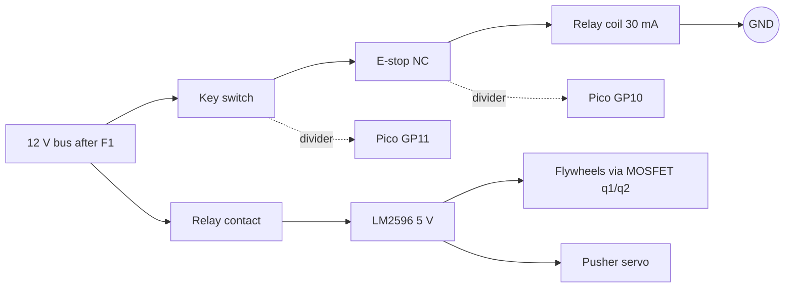

# cuas-lite wiring, pin to pin

GENERATED by `examples/cuas-lite/gen_wiring.py` from `assemblies/cuas-lite.toml` (the wires, pins and lengths) and the part files (pin names). Do not edit by hand: change the assembly or the rules
at the top of the script and run it again. `python3 examples/cuas-lite/gen_wiring.py --check` fails if this file is stale. Firmware pins: `firmware/cuas-lite-rp2040/include/pins.h`.

Colour and fuse columns are suggestions (not modelled by the DRC). Lengths are the assembly's estimates in metres, without slack for strain relief. Pin names are the part files' connector pin
names (the Pico row `GP12` is header pin 16, shown only as the name). Gauge is the wire part of the assembly.

Fuse F1 is the inline ATC blade holder between the XT60 and the bus. Fit a **10 A** blade (the listing ships 15-40 A: too big). Worst case at 12 V is about 5 A [est, from the part files' currents] (Jetson about 1.3 A, two steppers at 1.2 A RMS about 1 A, flywheels
and servo through the buck about 2.5 A); 10 A protects the 18 AWG leads, not the 22 AWG key and coil branch (30 mA load). [est] If you want that branch protected too, add a 0.5 A inline fuse at the key; it is not in the BOM.

## Weapon-rail interlock (hardware, independent of the Pico)

```
12 V bus (after F1)
   |-------------------------------+
   |                               |
  KEY (COM-NO, rated 1 A)      relay contact SW (Songle SRD-12VDC-SL-C, 10 A)
   |                               |
  E-STOP (NC contact)              +--> LM2596 buck (5 V) --+--> flywheel motors x2 (low side: MOSFET q1/q2, flyback d1/d2)
   |                                                        +--> pusher servo
  relay COIL (30 mA) --> GND

key off OR E-stop pressed OR any broken wire in the coil loop  =>  coil dead  =>  contact open  =>  5 V weapon rail dead.
Sense taps (33k/10k dividers) read the key node and the E-stop node into GP11 / GP10 for the firmware; they do not control the rail.
```

Mermaid form of the same diagram:



## 1. Power rail (12 V in, fuse, bus, returns)

| wire | from | to | gauge | colour | length m | fuse |
|---|---|---|---|---|---|---|
| psu_cord | psu.DC+ | xt60.+ | 18 AWG | red (12 V) | psu cord | upstream of F1 |
| psu_cord | psu.DC- | xt60.- | 18 AWG | black | psu cord | upstream of F1 |
| xt60_fuse | xt60.+ | fuse.IN | 18 AWG | red (12 V) | 0.12 | upstream of F1 |
| fuse_jetson | fuse.OUT | jetson.DC+ | 18 AWG | red (12 V) | 0.20 | F1 10 A |
| gnd_jetson | jetson.DC- | xt60.- | 18 AWG | black | 0.20 | F1 10 A |
| fuse_tmc_pan | fuse.OUT | tmc_pan.VM | 18 AWG | red (12 V) | 0.15 | F1 10 A |
| gnd_tmc_pan | tmc_pan.GND | xt60.- | 18 AWG | black | 0.20 | F1 10 A |
| fuse_tmc_tilt | fuse.OUT | tmc_tilt.VM | 18 AWG | red (12 V) | 0.17 | F1 10 A |
| gnd_tmc_tilt | tmc_tilt.GND | xt60.- | 18 AWG | black | 0.22 | F1 10 A |

## 2. Weapon rail (key + E-stop + relay coil, relay contact, 5 V buck)

| wire | from | to | gauge | colour | length m | fuse |
|---|---|---|---|---|---|---|
| fuse_key | fuse.OUT | key.COM | 22 AWG | red/white (switched 12 V) | 0.30 | F1 10 A |
| key_estop | key.NO | estop.NC1 | 22 AWG | red/white (switched 12 V) | 0.12 | F1 10 A |
| estop_coil | estop.NC2 | relay.A1 | 22 AWG | red/white (switched 12 V) | 0.12 | F1 10 A |
| coil_gnd | relay.A2 | xt60.- | 22 AWG | black | 0.30 | F1 10 A |
| fuse_relay | fuse.OUT | relay.COM | 18 AWG | red (12 V) | 0.25 | F1 10 A |
| relay_buck | relay.NO | buck.IN+ | 18 AWG | red (12 V) | 0.08 | F1 10 A |
| gnd_buck | buck.IN- | xt60.- | 18 AWG | black | 0.30 | F1 10 A |
| sense_key_top | key.NO | r_kt.RAIL | 26 AWG | white | 0.30 | - |
| sense_key_mid | r_kt.SIG | pico.GP11 | 26 AWG | white | 0.05 | - |
| sense_key_bot | r_kt.SIG | r_kb.SIG | 26 AWG | white | 0.03 | - |
| sense_key_gnd | r_kb.GND | pico.GND | 26 AWG | black | 0.06 | - |
| sense_estop_top | estop.NC2 | r_et.RAIL | 26 AWG | white | 0.30 | - |
| sense_estop_mid | r_et.SIG | pico.GP10 | 26 AWG | white | 0.05 | - |
| sense_estop_bot | r_et.SIG | r_eb.SIG | 26 AWG | white | 0.03 | - |
| sense_estop_gnd | r_eb.GND | pico.GND | 26 AWG | black | 0.06 | - |

## 3. Flywheel MOSFETs (gate, drain, source, flyback, motor supply)

| wire | from | to | gauge | colour | length m | fuse |
|---|---|---|---|---|---|---|
| rail_fw_pos | buck.OUT+ | fw_motor_pos.M+ | 22 AWG | orange (5 V rail) | 0.85 | F1 10 A upstream; buck current limit |
| rail_fw_neg | buck.OUT+ | fw_motor_neg.M+ | 22 AWG | orange (5 V rail) | 0.85 | F1 10 A upstream; buck current limit |
| fw_pos_drain | fw_motor_pos.M- | q1.D | 22 AWG | orange (5 V rail) | 0.85 | F1 10 A upstream; buck current limit |
| fw_neg_drain | fw_motor_neg.M- | q2.D | 22 AWG | orange (5 V rail) | 0.85 | F1 10 A upstream; buck current limit |
| fb_q1 | d1.A | fw_motor_pos.M- | 22 AWG | orange (5 V rail) | 0.85 | F1 10 A upstream; buck current limit |
| fb_q1 | d1.K | fw_motor_pos.M+ | 22 AWG | orange (5 V rail) | 0.85 | F1 10 A upstream; buck current limit |
| fb_q2 | d2.A | fw_motor_neg.M- | 22 AWG | orange (5 V rail) | 0.85 | F1 10 A upstream; buck current limit |
| fb_q2 | d2.K | fw_motor_neg.M+ | 22 AWG | orange (5 V rail) | 0.85 | F1 10 A upstream; buck current limit |
| q1_source | q1.S | buck.OUT- | 22 AWG | orange (5 V rail) | 0.10 | F1 10 A upstream; buck current limit |
| q2_source | q2.S | buck.OUT- | 22 AWG | orange (5 V rail) | 0.10 | F1 10 A upstream; buck current limit |
| gp12_gate | pico.GP12 | r_gate.SIG | 26 AWG | white | 0.08 | - |
| gate_q1 | r_gate.SIG | q1.G | 26 AWG | white | 0.06 | - |
| gate_q2 | r_gate.SIG | q2.G | 26 AWG | white | 0.06 | - |
| gate_pulldown_gnd | r_gate.GND | pico.GND | 26 AWG | black | 0.08 | - |

## 4. Pusher servo

| wire | from | to | gauge | colour | length m | fuse |
|---|---|---|---|---|---|---|
| rail_servo | buck.OUT+ | servo.V+ | 22 AWG | orange (5 V) | 0.85 | F1 10 A upstream; buck current limit |
| rail_servo | buck.OUT- | servo.GND | 22 AWG | black | 0.85 | F1 10 A upstream; buck current limit |
| gp14_servo | pico.GP14 | servo.SIGNAL | 26 AWG | white | 0.85 | - |

## 5. Hall sensors (pan, tilt)

| wire | from | to | gauge | colour | length m | fuse |
|---|---|---|---|---|---|---|
| jetson_5v_hall_pan | jetson.5V0 | hall_pan.VCC | 26 AWG | orange (5 V) | 0.35 | - |
| jetson_5v_hall_pan | jetson.GND | hall_pan.GND | 26 AWG | black | 0.35 | - |
| hall_pan_to_tilt_power | hall_pan.VCC | hall_tilt.VCC | 26 AWG | orange (5 V) | 0.80 | - |
| hall_pan_to_tilt_power | hall_pan.GND | hall_tilt.GND | 26 AWG | black | 0.80 | - |
| hall_pan_out | hall_pan.OUT | r_hp.SIG | 26 AWG | yellow | 0.35 | - |
| hall_pan_gp8 | r_hp.SIG | pico.GP8 | 26 AWG | yellow | 0.05 | - |
| hall_tilt_out | hall_tilt.OUT | r_ht.SIG | 26 AWG | yellow | 0.80 | - |
| hall_tilt_gp9 | r_ht.SIG | pico.GP9 | 26 AWG | yellow | 0.05 | - |
| v3_hp | pico.3V3 | r_hp.RAIL | 26 AWG | brown (3.3 V) | 0.06 | - |
| v3_ht | r_hp.RAIL | r_ht.RAIL | 26 AWG | brown (3.3 V) | 0.03 | - |

## 6. Pico to TMC2209 x 2 (pan, tilt: STEP/DIR/EN, UART, straps, VIO, motor leads)

| wire | from | to | gauge | colour | length m | fuse |
|---|---|---|---|---|---|---|
| v3_en_pan | r_ht.RAIL | r_en_pan.RAIL | 26 AWG | brown (3.3 V) | 0.03 | - |
| v3_en_tilt | r_en_pan.RAIL | r_en_tilt.RAIL | 26 AWG | brown (3.3 V) | 0.03 | - |
| v3_ms_pan | r_en_tilt.RAIL | r_ms_pan.RAIL | 26 AWG | brown (3.3 V) | 0.03 | - |
| v3_ms_tilt | r_ms_pan.RAIL | r_ms_tilt.RAIL | 26 AWG | brown (3.3 V) | 0.03 | - |
| vio_pan | r_ms_pan.RAIL | tmc_pan.VIO | 26 AWG | brown (3.3 V) | 0.08 | - |
| vio_tilt | r_ms_tilt.RAIL | tmc_tilt.VIO | 26 AWG | brown (3.3 V) | 0.08 | - |
| pan_step_dir | pico.GP2 | tmc_pan.STEP | 26 AWG | green | 0.10 | - |
| pan_step_dir | pico.GP3 | tmc_pan.DIR | 26 AWG | blue | 0.10 | - |
| pan_step_dir | pico.GND | tmc_pan.GND | 26 AWG | black | 0.10 | - |
| pan_en_a | pico.GP4 | r_en_pan.SIG | 26 AWG | white | 0.08 | - |
| pan_en_b | r_en_pan.SIG | tmc_pan.EN | 26 AWG | white | 0.06 | - |
| pan_ms1 | r_ms_pan.SIG | tmc_pan.MS1 | 26 AWG | grey | 0.06 | - |
| pan_ms2 | r_ms_pan.SIG | tmc_pan.MS2 | 26 AWG | grey | 0.06 | - |
| pan_uart_tx | pico.GP20 | r_su_pan.A | 26 AWG | violet | 0.08 | - |
| pan_uart_line | r_su_pan.B | tmc_pan.PDN_UART | 26 AWG | violet | 0.06 | - |
| pan_uart_rx | pico.GP21 | r_su_pan.B | 26 AWG | violet | 0.08 | - |
| pan_motor_leads | tmc_pan.1A | nema_pan.A1 | 24 AWG | black (A+) | 0.25 | - |
| pan_motor_leads | tmc_pan.1B | nema_pan.A2 | 24 AWG | green (A-) | 0.25 | - |
| pan_motor_leads | tmc_pan.2A | nema_pan.B1 | 24 AWG | red (B+) | 0.25 | - |
| pan_motor_leads | tmc_pan.2B | nema_pan.B2 | 24 AWG | blue (B-) | 0.25 | - |
| tilt_step_dir | pico.GP5 | tmc_tilt.STEP | 26 AWG | green | 0.10 | - |
| tilt_step_dir | pico.GP6 | tmc_tilt.DIR | 26 AWG | blue | 0.10 | - |
| tilt_step_dir | pico.GND | tmc_tilt.GND | 26 AWG | black | 0.10 | - |
| tilt_en_a | pico.GP7 | r_en_tilt.SIG | 26 AWG | white | 0.08 | - |
| tilt_en_b | r_en_tilt.SIG | tmc_tilt.EN | 26 AWG | white | 0.06 | - |
| tilt_ms1 | r_ms_tilt.SIG | tmc_tilt.MS1 | 26 AWG | grey | 0.06 | - |
| tilt_ms2 | r_ms_tilt.SIG | tmc_tilt.MS2 | 26 AWG | grey | 0.06 | - |
| tilt_uart_tx | pico.GP0 | r_su_tilt.A | 26 AWG | violet | 0.08 | - |
| tilt_uart_line | r_su_tilt.B | tmc_tilt.PDN_UART | 26 AWG | violet | 0.06 | - |
| tilt_uart_rx | pico.GP1 | r_su_tilt.B | 26 AWG | violet | 0.08 | - |
| tilt_motor_leads | tmc_tilt.1A | nema_tilt.A1 | 24 AWG | black (A+) | 0.80 | - |
| tilt_motor_leads | tmc_tilt.1B | nema_tilt.A2 | 24 AWG | green (A-) | 0.80 | - |
| tilt_motor_leads | tmc_tilt.2A | nema_tilt.B1 | 24 AWG | red (B+) | 0.80 | - |
| tilt_motor_leads | tmc_tilt.2B | nema_tilt.B2 | 24 AWG | blue (B-) | 0.80 | - |

## 7. Jetson USB and 5 V

| wire | from | to | gauge | colour | length m | fuse |
|---|---|---|---|---|---|---|
| jetson_5v_pico | jetson.5V0 | pico.VSYS | 26 AWG | orange (5 V) | 0.15 | - |
| jetson_5v_pico | jetson.GND | pico.GND | 26 AWG | black | 0.15 | - |
| usb_pico_jetson | pico.VBUS | jetson.VBUS | 28 AWG | red | 0.30 | - |
| usb_pico_jetson | pico.D- | jetson.D- | 28 AWG | white | 0.30 | - |
| usb_pico_jetson | pico.D+ | jetson.D+ | 28 AWG | green | 0.30 | - |
| usb_pico_jetson | pico.GND | jetson.GND | 28 AWG | black | 0.30 | - |
| usb_brio_jetson | brio.VBUS | jetson.VBUS | 28 AWG | red | 1.00 | - |
| usb_brio_jetson | brio.D- | jetson.D- | 28 AWG | white | 1.00 | - |
| usb_brio_jetson | brio.D+ | jetson.D+ | 28 AWG | green | 1.00 | - |
| usb_brio_jetson | brio.GND | jetson.GND | 28 AWG | black | 1.00 | - |

## Wire totals (length x conductors, metres, from the assembly)

- 18 AWG: 1.9 m
- 22 AWG: 9.5 m
- 24 AWG: 4.2 m
- 26 AWG: 7.8 m
- 28 AWG: 5.2 m
